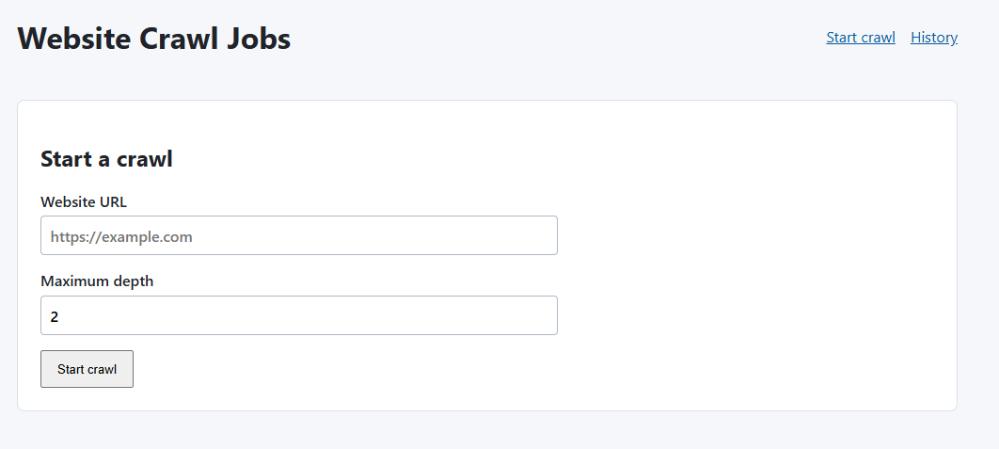

# Website Crawl Jobs

A small .NET 8 / React system for submitting bounded website crawls. The API persists a job and publishes a RabbitMQ message; a separate worker fetches and parses HTML pages, writes page/edge results to PostgreSQL, and the UI polls for progress.

## Run locally

Requirements: Docker Desktop with Compose. Run these commands from the repository root:

```powershell
docker compose up --build -d
docker compose ps
```

If a .NET image build fails with `exec /bin/sh: exec format error` even though Docker reports the correct platform, retry from the repository root with Docker's legacy builder. Build the .NET services and frontend separately, then start the stack:

```powershell
$env:DOCKER_BUILDKIT = "0"
$env:COMPOSE_DOCKER_CLI_BUILD = "0"
docker compose build api worker
docker compose build frontend
docker compose up -d
docker compose ps
```

Wait for `db` and `rabbitmq` to report healthy and the other services to be running. Check API and worker health:

```powershell
Invoke-RestMethod http://localhost:8080/health
Invoke-RestMethod http://localhost:8081/health
```

The API's interactive Swagger UI is available at <http://localhost:8080/swagger> in the local Compose setup. It documents the job endpoints, request/response shapes, and status codes. Swagger is enabled only in the Development environment.

For a UI smoke test, open <http://localhost:5173>, submit `https://example.com` with max depth `1`, and confirm the Job Details page shows the job ID and updates to `Completed` with its page tree. Then open **History** and confirm the job appears there; open it again to verify navigation back to its details. Loopback and private-network URLs are intentionally rejected.

### Start Crawl screen



To submit and inspect a job through the API instead:

```powershell
$job = Invoke-RestMethod -Method Post `
  -Uri http://localhost:8080/api/jobs `
  -ContentType 'application/json' `
  -Body '{"url":"https://example.com","maxDepth":1}'

$id = $job.jobId
Invoke-RestMethod "http://localhost:8080/api/jobs/$id"
Invoke-RestMethod "http://localhost:8080/api/jobs/$id/tree"
```

The status may initially be `Pending` or `Running`; check again until it reaches `Completed` or `Failed`. RabbitMQ management is at <http://localhost:15672> (default guest/guest). For service diagnostics, run `docker compose logs api worker db rabbitmq frontend`.

Stop with `docker compose down`. PostgreSQL data is kept in the `crawler-data` volume; `docker compose down -v` removes that data.

## API

- `POST /api/jobs` — body `{"url":"https://example.com","maxDepth":2}`; returns `202 {"jobId":"..."}`
- `POST /api/jobs/{jobId}/cancel` — cooperatively cancel a pending/running job; returns `204`, `404` for an unknown job, or `409` if it is already terminal
- `GET /api/jobs/{jobId}` — status, timestamps, page count, and failure reason
- `GET /api/jobs/{jobId}/tree` — discovered-page tree and per-page domain link ratio
- `GET /api/jobs?page=1&pageSize=20` — recent-first, paginated history

`maxDepth` defaults to 2 and is restricted to 0–10. The worker caps a job at 200 distinct normalized URLs.

## Architecture and decisions

- `CrawlerJob` is the HTTP API, `Crawler.Worker` is a separate process, and `Crawler.Infrastructure` holds shared contracts and persistence helpers.
- PostgreSQL is the source of truth. `crawl_jobs` is indexed by creation time; pages are unique on `(job_id, url)`, and edges are unique on `(job_id, parent_url, child_url)`. SQL reads for status/history/tree are separate from crawl execution.
- PostgreSQL was chosen for a portable, lightweight Docker setup; pgAdmin is optional for manual database inspection. See [ADR 0001](docs/adr/0001-use-postgresql.md).
- MassTransit provides typed `CrawlMessage { "jobId": "<guid>" }` publishing and RabbitMQ consumer setup. The worker consumes from `crawl-jobs`. MassTransit uses durable RabbitMQ topology and its default error transport; after retries are exhausted, the original message is moved to `crawl-jobs_error` and a `Fault<CrawlMessage>` is published. Inspect/replay or purge failed messages through RabbitMQ management.
- Integration tests use Testcontainers to start isolated PostgreSQL and RabbitMQ containers; see [ADR 0004](docs/adr/0004-containerized-integration-tests.md).
- MassTransit applies two in-memory retries after the original attempt (1s and 2s intervals). Exceptions from request timeouts, server errors, database access, or parsing are retried; HTTP 4xx responses and non-HTML pages are skipped. On the final attempt the worker marks the job failed and lets the exception propagate so MassTransit routes the failed message to its error queue. The in-memory retry policy is intentionally short and does not provide delayed redelivery across process restarts.
- Page/edge uniqueness plus `ON CONFLICT DO NOTHING` makes persisted crawl results safe under redelivery. A redelivered partial crawl can resume traversal from already-persisted outgoing edges.
- The starting domain is the initial URL's host (case-insensitive). Relative and fragment links are normalized; only HTTP(S) links contribute to the ratio. External HTTP(S) links are recorded as edges and count in the denominator but are not crawled. A page with no eligible links has ratio 0.
- Crawl submission and every worker request reject credentials, non-HTTP(S) URLs, and hosts with any non-globally-routable DNS answer. The worker resolves and validates addresses again at connection time and connects directly to a validated IP to mitigate DNS rebinding. Redirects are manual, limited to five hops, and may not change host. See [ADR 0005](docs/adr/0005-public-url-policy-and-cancellation.md).
- Cancellation is cooperative: the in-flight response is fully read and its page result persisted, then the worker stops before requesting another page. The job remains `Canceled`; `completed_at` records the terminal timestamp and the UI displays any partial tree.
- The UI uses polling rather than SSE/SignalR. It shows job state, timestamps, count-based progress, failure text, result tree, and history.
- Swagger UI documents the API in Development only; the local Compose API explicitly runs in Development, while deployed production environments do not expose the docs by default. See [ADR 0006](docs/adr/0006-development-swagger-ui.md).

## Testing

Run all .NET tests, including the container-backed crawl pipeline integration test, with Docker running:

```powershell
dotnet test .\Crawler.Tests\Crawler.Tests.csproj
```

Testcontainers starts and removes its own PostgreSQL and RabbitMQ containers. Integration tests submit jobs through the real API, verify worker retries, duplicate delivery, and recovery after partial persistence against deterministic local pages, and check persisted results. No Docker Compose services or external websites are needed for tests. Run only the integration tests with:

```powershell
dotnet test .\Crawler.Tests\Crawler.Tests.csproj --filter Category=Integration
```

### Require CI on `main`

The GitHub Actions workflow at `.github/workflows/ci.yml` runs the Release test suite on pushes and pull requests targeting `main`. To require it before merging, create a branch protection rule or ruleset for `main` in the repository's **Settings**. Enable **Require status checks to pass before merging** and select **Build and test** as a required check. If the check is not listed yet, push the workflow and let it complete once, then return to the rule and select it. This repository setting requires GitHub repository admin access and cannot be enabled by the workflow file itself.

## Delivery approach

Work is prioritized as ranked vertical slices: (1) submit a URL and acknowledge a persisted/published job; (2) crawl bounded HTML and calculate link metrics; (3) persist lifecycle/progress and idempotent page/edge results; (4) inspect the completed result tree; (5) browse job history; and (6) run and observe the full local stack. Each slice aims to provide an end-to-end user capability instead of completing all backend or frontend work separately. The detailed acceptance checks and current status are in [IMPLEMENTATION-NOTES.md](IMPLEMENTATION-NOTES.md).

Use a test-first loop where practical: derive a focused test from the requirement, observe it fail, implement the smallest behavior to pass, then refactor with tests green. Prefer unit tests for deterministic URL and metric rules, fixture tests for HTML parsing, and integration tests for API/database/broker boundaries. Existing tests were written after the initial implementation rather than strictly test-first; the remaining test backlog is documented in the implementation notes.

## What was prioritized, cut, and next

- **Implemented first:** durable job lifecycle and clear API/worker boundaries, then bounded crawl persistence and messaging. Those paths establish the assignment's core asynchronous flow.
- **Cut / simplified:** no authentication or rate limiting is built into the application; production deployments are expected to enforce both at the hosting boundary (for example, an identity-aware API gateway and ingress/load balancer policies). The local Compose setup is for development, not a production security boundary. Other omissions include configurable page limits, content rendering, and SSE. Direct publish follows the job insert rather than using a transactional outbox.
- **Next with more time:** add a transactional outbox and stronger poison-message replay/observability, delayed redelivery across process restarts, load/performance tests, crawl politeness limits, and a UI pagination control. The current worker's 200-page ceiling is a constant and should become configuration.

See [IMPLEMENTATION-NOTES.md](IMPLEMENTATION-NOTES.md) for the ongoing requirement breakdown and decision log.
